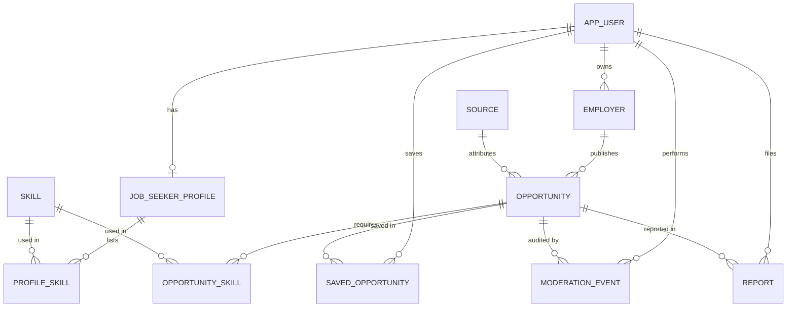

# Database Schema (DIP-8)

Initial PostgreSQL schema for the MVP. It implements the minimum domain model from `docs/06_requirements.md`.

- `schema.sql` — tables, enums, constraints and indexes.
- `er_diagram.mmd` — editable ER diagram (Mermaid); rendered below.

## Design decisions

| Decision | Reason | Requirement |
|---|---|---|
| `opportunity.status` enum with `draft → pending → published / rejected → expired → archived` | Pending listings are never public; expired ones leave search but keep history | FR-09, FR-10 |
| `moderation_event` stores actor, from/to status, reason and time | Every status change is auditable | FR-10 |
| `source` table with a `permission` column and `opportunity.source_url` | Each listing shows its origin and how it may be used; no scraping without permission | FR-05, NFR-06 |
| Partial unique index on `source_url` for pending/published listings | Blocks an exact duplicate of an active listing; fuzzy duplicates are flagged by the API for moderators | FR-11 |
| `search_vector` (generated `tsvector`, `simple` config) with a GIN index | Fast lexical search over title and description; `simple` avoids wrong stemming for Kazakh text | FR-02, NFR-01 |
| `skill.aliases` array | ru/kk/en synonyms for skills (e.g. «Питон» → Python) | FR-02, risk register |
| Composite primary key on `saved_opportunity` | One user's shortlist is private and has no duplicates | FR-06 |
| No CV, gender, age or other sensitive columns | Data minimisation; matching must not use protected characteristics | NFR-04, NFR-08 |

## Load the schema locally

```bash
createdb internships
psql -d internships -f docs/database/schema.sql
```

## ER diagram



Full diagram with attributes: `er_diagram.mmd`.
