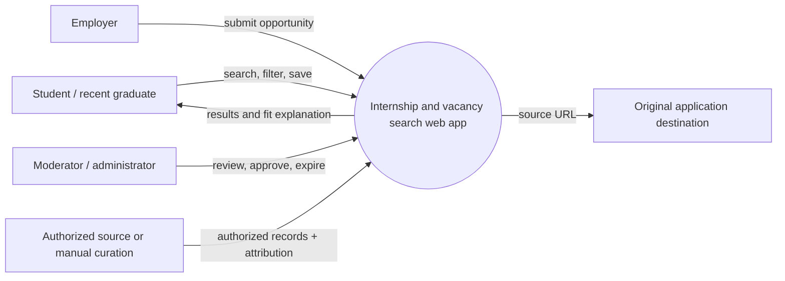
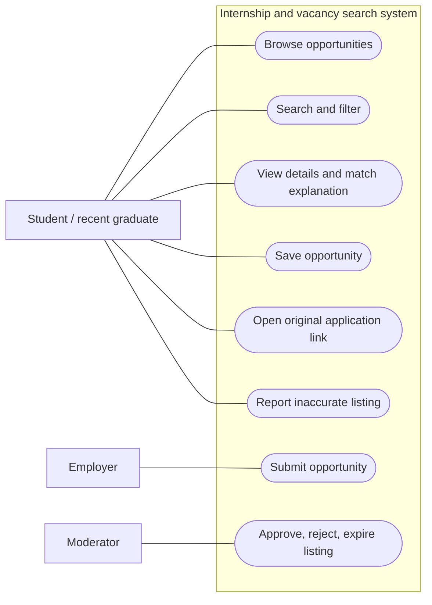
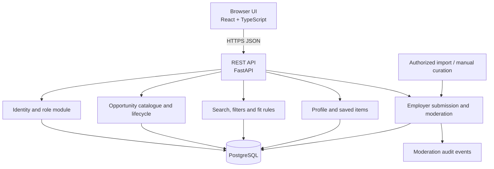

# Architecture and Diagrams

## Architecture decision

Use a modular monolith for the MVP. The client calls one REST API. The API enforces roles and business rules, queries PostgreSQL, and returns normalized opportunity records. The first data flow is employer-submitted or manually curated with permission; external board scraping is excluded. Any later integration must use an authorized API or written permission and preserve attribution and freshness metadata.

## System context

Source: [`architecture/context.mmd`](architecture/context.mmd) · PNG export: [`report_assets/context.png`](../report_assets/context.png)

Actors: job seeker, employer, moderator/admin, and an authorized external listing source. The application provides discovery and curation; application decisions and final submissions remain with the user and original employer.

## Use cases

Source: [`architecture/use_case.mmd`](architecture/use_case.mmd) · PNG export: [`report_assets/use_case.png`](../report_assets/use_case.png)

## Component diagram

Source: [`architecture/component.mmd`](architecture/component.mmd) · PNG export: [`report_assets/components.png`](../report_assets/components.png)

## API boundary (draft)

- `GET /opportunities` - query, filters, sort, pagination.
- `GET /opportunities/{id}` - detail and source metadata.
- `POST /auth/register`, `POST /auth/login`, `DELETE /account` - account lifecycle.
- `GET/PUT /profile` - minimal jobseeker preferences.
- `GET/POST/DELETE /saved` - private shortlist.
- `POST /employer/opportunities` - create pending listing.
- `GET /moderation/queue`, `PATCH /moderation/{id}` - moderator workflow.
- `POST /opportunities/{id}/reports` - report incorrect listing.

These endpoints are a draft contract; confirm names and authorization details during implementation.

## Core data flow

1. A moderator or authorized employer submits a record; validation checks required fields, source, publication date, and expiry.
2. Moderator review moves a valid record from `pending` to `published` and writes an audit event.
3. The search API filters active records first, applies text matching, then deterministic ordering and pagination.
4. A job seeker can open the original destination, save the catalogue record, and see the rule-based fit breakdown.
5. A scheduled cleanup marks past-expiry records `expired`; it does not delete the audit trail.
